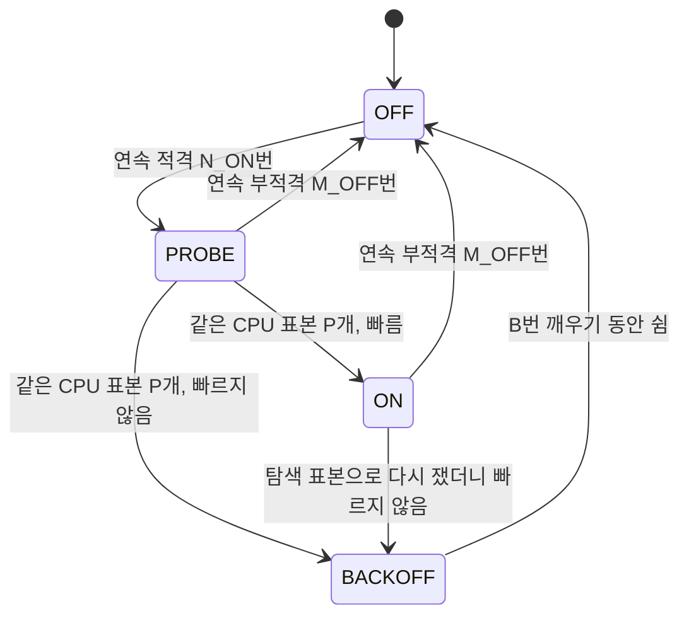

# 자동 직통 모드 정책 명세서 v0 (초안)

- 작성: 이준원 (C, 정책) · 2026-11-24
- 기준 소스: Linux v6.18 (`7d0a66e`), `kernel/seccomp.c`. 행 번호는 모두 이 커밋 기준이다.
- 상태: 11/26 회의 공유용 초안. 11/28(M1)에 v1으로 확정한다.

## 0. 요약

- 사용자 알림 경로의 깨우기 두 방향(① 대상 → 감독, ② 감독 → 대상)마다 정책 상태를 하나씩 둔다.
- 매 깨우기마다 **적격 조건(E1~E5)**으로 "지금이 번갈아 패턴인가"를 보고, 방향별 **상태 기계(OFF/PROBE/ON/BACKOFF)**가 같은 CPU로 깨울지 정한다.
- 같은 CPU 깨우기가 실제로 빠른지는 커널이 직접 잰 지연으로 판단한다(`μ(같은 CPU) + κ·σ(같은 CPU) < μ(일반)`).
- 감독 프로그램이 `SECCOMP_USER_NOTIF_FD_SYNC_WAKE_UP`을 켰으면 지금처럼 항상 같은 CPU로 깨우고, 정책은 관여하지 않는다.

## 1. 훅 지점 (6.18 소스로 확인)

| 지점 | 위치 | 현재 코드 | 정책이 하는 일 | 잠금 |
| --- | --- | --- | --- | --- |
| 알림 게시 + 깨우기 ① | `seccomp_do_user_notification()` 1163행, 게시 1183행, 깨우기 1186~1190행 | 플래그가 있으면 `wake_up_poll_on_current_cpu(&match->wqh, …)`, 없으면 `wake_up_poll()` | 게시 시각 기록, 방향 ① 결정 | `notify_lock` 잡은 상태 |
| 대상 대기와 깨어남 | 같은 함수 1195~1220행 (`do { … } while (n.state != SECCOMP_NOTIFY_REPLIED)`) | 잠금을 풀고 `wait_for_completion_*()`(1200·1202행), 깨어나면 다시 잠금 | 깨어난 시각 기록, 방향 ② 표본 반영 | 깨어난 뒤 재획득 |
| 감독 받기 진입·깨어남 | `seccomp_notify_recv()` 1552행, `recv_wait_event()` 1524행(1546행 `schedule()`), 1568행 반환 뒤 잠금 | 요청이 없으면 `filter->wqh`에서 잠듦 | 받기 진입 시각(E5), 받은 시각 기록, 방향 ① 표본 반영 | 깨어난 뒤 획득 |
| 감독 응답 + 깨우기 ② | `seccomp_notify_send()` 1625행, REPLIED 1659행, 깨우기 1663~1666행 | 플래그가 있으면 `complete_on_current_cpu(&knotif->ready)`, 없으면 `complete()` | 응답 시각 기록, 방향 ② 결정, E4 갱신 | `notify_lock` 잡은 상태 |
| 플래그 설정 | `seccomp_notify_set_flags()` 1696행 | ioctl로 `notif->flags` 설정 | 변경 없음 (프로그램 선택 존중) | `notify_lock` |
| 알림 상태 | `struct notification` 149~154행 (`requests`, `flags`, `next_id`, `notifications`) | | 방향별 정책 상태와 카운터 추가 | |
| 알림 하나의 상태 | `struct seccomp_knotif` 61~100행 | | 시각과 결정 기록 추가 | |
| sysctl | `seccomp_sysctl_table` 2490행, `register_sysctl_init("kernel/seccomp", …)` 2507행 | `actions_avail`, `actions_logged` | 정책 스위치와 파라미터 추가 | |

같은 CPU 깨우기의 실제 동작은 `kernel/sched/fair.c` 8583~8585행이다. `WF_CURRENT_CPU`가 있고 깨우는 CPU가 깨울 태스크의 허용 CPU(`p->cpus_ptr`)에 있을 때만 현재 CPU를 고른다.

## 2. 소스를 읽고 정한 것 (계획서와 다른 점 포함)

| # | 발견 | 명세에 반영한 내용 |
| --- | --- | --- |
| N1 | 게시·받음·응답·깨어남 네 시점이 모두 `notify_lock`(mutex) 안에서 일어나거나 직후에 그 잠금을 잡는다 | 정책 상태는 **별도 잠금 없이 `notify_lock`으로 보호**한다. 시각만 잠금 전에 지역 변수로 찍고, 상태 갱신은 잠금 안에서 한다 |
| N2 | 깨우기 ①의 대기열 `filter->wqh`에는 `recv`에서 자는 감독뿐 아니라 poll/epoll 등록자도 들어 있다 | 계획서의 E1(`wq_has_sleeper()`)은 epoll을 쓰는 감독에서 항상 참이라 부정확하다. **`recv_wait_event()`의 `schedule()` 앞뒤로 올리고 내리는 카운터(`recv_sleepers`)**로 판단한다 |
| N3 | `notif->requests`는 아직 안 받은(INIT) 알림 수만 센다. 받았지만 응답 안 한(SENT) 알림은 목록을 돌아야 알 수 있다 | `struct notification`에 **처리 중 알림 수 `inflight`** 를 추가한다. 게시(1183행)에서 올리고 목록 제거(1246행)에서 내린다 |
| N4 | 대상은 응답 말고도 addfd 메시지, 시그널, 감독 종료로도 깨어난다. `SECCOMP_ADDFD_FLAG_SEND`(1770행)도 응답 역할을 하지만 일반 `complete()`를 쓴다 | 방향 ② 표본은 **`seccomp_notify_send()`가 응답을 기록한 경우(`t_send != 0`)이고 에러 없이 깨어난 경우**만 쓴다. addfd+SEND 경로는 v1 범위 밖이다(B의 M3 항목과 함께 검토) |
| N5 | 받은 시각은 감독이 `recv_wait_event()`에서 깨어난 시각이다. 감독이 자고 있지 않았으면 이 값은 깨우기 지연이 아니다 | 지연 표본은 **결정 당시 적격이었던 깨우기만** μ, σ에 넣는다 |
| N6 | E5(응답 → 다음 받기)를 재려면 받기 **진입** 시각이 필요하다 | 계획서의 네 시점에 **받기 진입**을 더해 다섯 시점으로 잰다(B와 조율) |
| N7 | seccomp sysctl이 이미 `kernel/seccomp/` 아래에 있다 | 스위치 이름을 계획서 가칭 `kernel.seccomp_auto_sync` 대신 **`kernel.seccomp.auto_sync`** 로 제안한다 |

## 3. 시각 측정 (다섯 시점)

시계는 `ktime_get_ns()`를 쓴다. 게시와 받음이 서로 다른 CPU에서 찍힐 수 있어서, CPU마다 따로인 `local_clock()`은 쓰지 않는다.

| 시점 | 찍는 곳 | 저장 |
| --- | --- | --- |
| `t_post` 게시 | 깨우기 ① 직전 (1186행 부근) | `knotif` |
| `t_enter` 받기 진입 | `seccomp_notify_recv()` 시작 | 지역 변수 → 잠금 안에서 E5 갱신 |
| `t_recv` 받음 | `recv_wait_event()` 반환 직후 (1568행 뒤) | `knotif` |
| `t_send` 응답 | 깨우기 ② 직전 (1663행 부근) | `knotif`, `notif->last_send` |
| `t_wake` 깨어남 | `wait_for_completion_*()` 반환 직후 (1200·1202행 뒤) | 지역 변수 |

| 값 | 계산 | 쓰는 곳 |
| --- | --- | --- |
| L1 (방향 ① 지연) | `t_recv − t_post` | 방향 ① 표본 |
| L2 (방향 ② 지연) | `t_wake − t_send` | 방향 ② 표본 |
| S (감독 처리 시간) | `t_send − t_recv` | E4 이동 평균 |
| G (복귀 시간) | `t_enter − 직전 last_send` | E5 이동 평균 |

## 4. 1층: 적격 조건

깨우기마다 그 방향의 조건을 **모두** 만족해야 적격이다. 부적격인 깨우기는 상태와 관계없이 **일반 깨우기**를 쓰고, 표본에도 넣지 않는다.

| 조건 | 판정식 (v0) | 방향 | 이유 |
| --- | --- | --- | --- |
| E1 감독이 받기에서 자는 중 | `atomic_read(&nf->recv_sleepers) > 0` | ① | 감독이 바쁘면 깨워도 바로 못 받는다 (N2) |
| E2 처리 중 알림이 하나뿐 | `nf->inflight == 1` | ①② | 여럿이면 둘이 동시에 일하는 상황이다 (N3) |
| E3 깨우는 CPU가 한가함 | `single_task_running()` | ①② | 다른 작업이 있으면 같은 CPU로 깨워도 그 뒤에 줄을 선다 |
| E4 감독 처리 시간이 짧음 | `S`의 이동 평균 `< T_SVC` (표본이 없으면 참) | ① | 처리가 길면 같은 CPU의 이득이 상대적으로 작다 |
| E5 감독이 곧 다시 받기로 돌아옴 | `G`의 이동 평균 `< T_GAP` (표본이 없으면 참) | ② | 감독이 곧 잠들어야 대상이 그 CPU를 바로 쓴다 |

- 방향 ① 적격 = E1 ∧ E2 ∧ E3 ∧ E4
- 방향 ② 적격 = E2 ∧ E3 ∧ E5
- `single_task_running()`(`kernel/sched/core.c` 5360행)은 `raw_rq()->nr_running == 1`을 읽는 순간 값이라 정확하지 않을 수 있다. 판단용 힌트로만 쓰고, 틀렸을 때의 손해는 3층의 이득 확인이 걸러 낸다.

## 5. 2층: 방향별 상태 기계



| 상태 | 적격일 때 깨우기 | 표본 | 나가는 조건 |
| --- | --- | --- | --- |
| OFF | 일반 | 일반(μ[0]) 쌓임 | 연속 적격 `N_ON`번 → PROBE |
| PROBE | 같은 CPU (K번째마다 일반) | 같은 CPU(μ[1])를 새로 모음 | 같은 CPU 표본 `P`개 → 빠르면 ON, 아니면 BACKOFF / 연속 부적격 `M_OFF`번 → OFF |
| ON | 같은 CPU (K번째마다 일반) | 탐색 왕복이 μ[0]을 갱신 | 연속 부적격 `M_OFF`번 → OFF / 새 μ[0]으로 다시 쟀더니 빠르지 않음 → BACKOFF |
| BACKOFF | 일반 | 일반 | `B`번 깨우기 → OFF. 들어올 때마다 `B`를 두 배로(`B_MAX`까지), ON에 성공하면 `B`를 초기값으로 |

계획서 의사코드와 다른 점은 두 가지다.
- PROBE 종료를 남은 깨우기 수가 아니라 **실제로 들어온 같은 CPU 표본 수**로 판단한다. 깨우기를 결정하는 시점에는 그 깨우기의 지연이 아직 재지지 않았기 때문이다.
- ON에서 "빠른가"를 매 깨우기가 아니라 **탐색 왕복으로 μ[0]이 새로 들어왔을 때만** 다시 판단한다. μ[0]은 ON 동안 K번에 한 번만 갱신되므로, 매번 판단해도 결과가 바뀌지 않고 흔들림만 커진다.

## 6. 3층: 적응형 기준

방향마다 일반(`[0]`)과 같은 CPU(`[1]`)의 지연을 따로 모은다. TCP의 SRTT·RTTVAR(RFC 6298)처럼 평균 μ와 흔들림 σ를 이동 평균으로 관리한다.

- 첫 표본: `μ = x`, `σ = x/2`. 0에서 시작하면 α = 1/8로 따라가는 동안 초반 수십 개 표본의 평균이 실제보다 크게 낮아 PROBE 판단이 틀린다.
- 이후: `err = x − μ`, `μ += err/8`, `σ += (|err| − σ)/4`. 나눗셈은 비트 이동으로 한다.
- 판단: `μ[1] + κ·σ[1] < μ[0]`일 때만 "빠르다". 둘 중 하나라도 표본이 없으면 "빠르지 않다".
- PROBE에 들어갈 때 `[1]`을 비운다. 환경이 바뀌었을 수 있어서 지난번 PROBE의 값을 쓰지 않는다.

## 7. 파라미터 (초기값)

| 파라미터 | 초기값 | 근거 |
| --- | --- | --- |
| `N_ON` | 8 | 잠깐의 우연한 일치로 켜지지 않게 |
| `P` | 16 | 이득을 판단할 최소 같은 CPU 표본 수 |
| `KAPPA` (κ) | 1 | 흔들림(σ)만큼의 차이는 이득으로 인정하지 않음 |
| α, β | 1/8, 1/4 | TCP와 같은 값, 비트 이동으로 계산 |
| `M_OFF` | 2 | 동시 처리로 바뀌면 빨리 끄되, 한 번 튀는 값에는 버팀 |
| `K` | 64 | 탐색(일반 깨우기) 비율을 약 1.6%로 제한 |
| `B` → `B_MAX` | 64 → 4096 | 효과 없는 환경에서 켜고 끄기를 반복하지 않게 |
| `T_SVC`, `T_GAP` | 미정 | M1 관찰 계획으로 실제 분포를 보고 M2 구간에 정함 (명세서 v2) |

## 8. 공통 틀 코드 초안 (C 담당)

```c
enum sap_state { SAP_OFF, SAP_PROBE, SAP_ON, SAP_BACKOFF };
enum { SAP_DIR_POST, SAP_DIR_REPLY };        /* ① 대상→감독, ② 감독→대상 */

struct sap_stat {
	u64 mu, sigma;
	u32 n;                                    /* 표본 수 */
};

struct sap_dir {
	u8  state;
	u8  recheck;                              /* ON: 새 μ[0]이 들어옴 */
	u16 streak;                               /* OFF: 연속 적격 */
	u16 bad;                                  /* PROBE·ON: 연속 부적격 */
	u32 tick;                                 /* 탐색 왕복 계산 */
	u32 backoff, backoff_left;
	struct sap_stat st[2];                    /* [0] 일반, [1] 같은 CPU */
};

/* struct notification에 추가 */
	u32 inflight;                             /* N3: 게시됐고 아직 목록에 있는 알림 */
	atomic_t recv_sleepers;                   /* N2: recv_wait_event()에서 자는 감독 */
	u64 last_send;                            /* E5 */
	struct sap_stat svc, gap;                 /* E4, E5 이동 평균 */
	struct sap_dir dir[2];

/* struct seccomp_knotif에 추가 */
	u64 t_post, t_recv, t_send;
	u8  elig[2], sync[2];                     /* 방향별: 결정 당시 적격이었나, 같은 CPU로 깨웠나 */
```

```c
static void sap_observe(struct sap_dir *d, bool sync, u64 x)
{
	struct sap_stat *s = &d->st[sync];
	s64 err;

	if (s->n++ == 0) {                        /* 첫 표본으로 초기화 */
		s->mu = x;
		s->sigma = x >> 1;
		return;
	}
	err = (s64)x - (s64)s->mu;
	s->mu += err >> 3;                        /* α = 1/8 */
	s->sigma += ((s64)abs(err) - (s64)s->sigma) >> 2;   /* β = 1/4 */

	if (!sync && d->state == SAP_ON)
		d->recheck = 1;
}

static bool sap_faster(const struct sap_dir *d)
{
	const struct sap_stat *g = &d->st[0], *c = &d->st[1];

	if (!g->n || !c->n)
		return false;
	return c->mu + sap_kappa * c->sigma < g->mu;
}

static void sap_enter(struct sap_dir *d, u8 state)
{
	d->state = state;
	d->bad = 0;
	switch (state) {
	case SAP_OFF:
		d->streak = 0;
		break;
	case SAP_PROBE:
		d->st[1] = (struct sap_stat){};       /* 같은 CPU 표본을 새로 모음 */
		break;
	case SAP_ON:
		d->recheck = 0;
		d->backoff = sap_b;                   /* 성공하면 백오프 초기화 */
		break;
	case SAP_BACKOFF:
		d->backoff_left = d->backoff;
		d->backoff = min(d->backoff * 2, sap_b_max);
		break;
	}
}

/* 깨우기 직전 (notify_lock 안). 반환값: 같은 CPU로 깨울지 */
static bool sap_decide(struct sap_dir *d, bool eligible)
{
	bool explore = (++d->tick % sap_k) == 0;

	switch (d->state) {
	case SAP_OFF:
		d->streak = eligible ? d->streak + 1 : 0;
		if (d->streak >= sap_n_on)
			sap_enter(d, SAP_PROBE);
		break;
	case SAP_PROBE:
	case SAP_ON:
		d->bad = eligible ? 0 : d->bad + 1;
		if (d->bad >= sap_m_off)
			sap_enter(d, SAP_OFF);
		else if (d->state == SAP_PROBE && d->st[1].n >= sap_p)
			sap_enter(d, sap_faster(d) ? SAP_ON : SAP_BACKOFF);
		else if (d->state == SAP_ON && d->recheck) {
			d->recheck = 0;
			if (!sap_faster(d))
				sap_enter(d, SAP_BACKOFF);
		}
		break;
	case SAP_BACKOFF:
		if (--d->backoff_left == 0)
			sap_enter(d, SAP_OFF);
		break;
	}
	return eligible && !explore &&
	       (d->state == SAP_PROBE || d->state == SAP_ON);
}
```

### 깨우기 ① 적용 예 (1183~1190행)

```c
	list_add_tail(&n.list, &match->notif->notifications);
	match->notif->inflight++;                                   /* 추가 */
	INIT_LIST_HEAD(&n.addfd);

	atomic_inc(&match->notif->requests);
	n.t_post = ktime_get_ns();                                  /* 추가 */
	if (match->notif->flags & SECCOMP_USER_NOTIF_FD_SYNC_WAKE_UP)
		sync = true;                                        /* 프로그램의 선택 존중 */
	else if (sap_enabled(SAP_DIR_POST)) {                       /* sysctl 비트 0 */
		n.elig[SAP_DIR_POST] = sap_eligible_post(match->notif);
		sync = sap_decide(&match->notif->dir[SAP_DIR_POST],
				  n.elig[SAP_DIR_POST]);
	}
	n.sync[SAP_DIR_POST] = sync;
	if (sync)
		wake_up_poll_on_current_cpu(&match->wqh, EPOLLIN | EPOLLRDNORM);
	else
		wake_up_poll(&match->wqh, EPOLLIN | EPOLLRDNORM);
```

방향 ① 표본은 `seccomp_notify_recv()`에서 알림을 고른 뒤(잠금 안) `knotif->elig[SAP_DIR_POST]`가 참이면 `sap_observe(…, knotif->sync[SAP_DIR_POST], t_recv − knotif->t_post)`로 넣는다. 방향 ②는 같은 틀을 `seccomp_notify_send()`(결정)와 대상의 깨어남(표본)에 적용한다(B 담당).

### 사용자 공간 시뮬레이션으로 확인한 동작

위 함수를 그대로 사용자 공간 C로 옮겨 가짜 지연(일반 약 12µs, 같은 CPU 약 3µs, ±20% 잡음)으로 돌린 결과다. 실제 커널 측정이 아니라 **상태 기계 논리만** 확인한 것이다.

| 시나리오 | 결과 |
| --- | --- |
| 번갈아 패턴, 같은 CPU가 빠름 | 7번째 깨우기에서 PROBE, 23번째에서 ON. 이후 같은 CPU 비율 98% (나머지는 탐색 왕복) |
| 동시 처리로 바뀜 (적격 10%) | 2번 연속 부적격으로 즉시 OFF, 같은 CPU 0% |
| 다시 번갈아 | 다시 23번 만에 ON |
| 같은 CPU가 빠르지 않은 환경 | PROBE에서 매번 BACKOFF, 쉬는 길이가 64 → 128 → … 로 늘어 2만 번 중 같은 CPU 0.8% |

## 9. 런타임 스위치 (제안)

| sysctl | 값 | 용도 |
| --- | --- | --- |
| `kernel.seccomp.auto_sync` | 0 끔 / 1 ①만 / 2 ②만 / 3 둘 다 | B0, C①, C②, C를 재부팅 없이 전환 |
| `kernel.seccomp.auto_sync_n_on` 등 | `N_ON`, `P`, `KAPPA`, `M_OFF`, `K`, `B`, `B_MAX`, `T_SVC`, `T_GAP` | 재부팅 없이 튜닝 |

스위치를 바꿀 때 이미 있는 정책 상태를 OFF로 되돌릴지는 열린 질문(10번)이다.

## 10. 담당 나누기와 일정

| 부분 | 담당 | 목표 |
| --- | --- | --- |
| 공통 틀: `sap_*` 함수, 구조체 필드, `inflight`·`recv_sleepers`, sysctl | C | **11/30~12/1 develop 합침** (B의 방향 ②가 이 위에서 시작) |
| 다섯 시점 기록 (`t_enter` 포함) | B | 계측 구현(11/27~28)에 `t_enter` 추가 |
| 방향 ①: E1·E4, 결정, 표본 | C | 12/3 (M2) |
| 방향 ②: E5, 결정, 표본 (N4의 조건 포함) | B | 12/3 (M2) |

## 11. 열린 질문 (11/26 회의)

1. **epoll 감독**: E1을 `recv_sleepers`로 바꾸면 epoll로 기다리는 감독은 방향 ①이 늘 부적격이라 정책이 켜지지 않는다. 손해는 없지만 이득도 없다. v1은 이대로 두고 M3의 "여러 알림·epoll 경우"(B)에서 다룰지 정한다.
2. **sysctl 이름**: `kernel.seccomp.auto_sync`로 바꿀지 정한다(N7).
3. **ADDFD_FLAG_SEND 응답 경로**: 현재 리눅스도 동기 모드를 적용하지 않는 경로다. 범위 밖으로 둘지 정한다(N4).
4. **스위치 전환 시 상태 초기화** 여부.
5. **E4·E5에 표본이 없을 때**: v0은 "참"(낙관)으로 둔다. 처음 몇 번은 E4·E5 없이 판단하게 된다.

## 12. M1까지 할 일 (관찰 계획 미리보기)

- 정책 없이(B0) 다섯 시점만 기록하는 커널로 `perf bench sched seccomp-notify`를 돌려 L1, L2, S, G의 분포를 본다.
- 같은 부하를 B1(플래그 켬)로도 돌려 VM에서 같은 CPU 깨우기가 실제로 빠른지 먼저 확인한다. 빠르지 않으면 M2의 "못 넘으면" 계획(원인 분석과 스스로 끄는 동작 시연)으로 간다.
- 분포를 보고 `T_SVC`, `T_GAP` 초기값을 정해 명세서 v2에 적는다.
